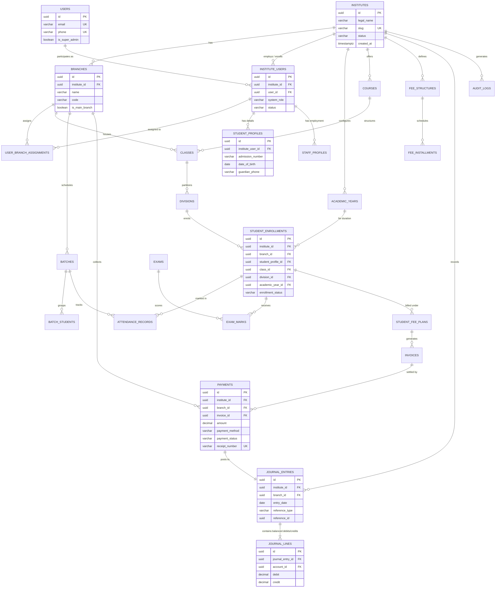

# InstituteOS — Database Design & Schema Specification

**Document Version:** 1.0.0  
**Status:** Approved Architectural Blueprint  
**Database Engine:** PostgreSQL 15+ (Supabase Managed Engine)  
**Multi-Tenancy Model:** Shared Database, Shared Schema with Logical Row-Level Security (RLS)  

---

## 1. Multi-Tenant Data Modeling Principles

InstituteOS implements a **Shared Database, Shared Schema** architecture. This pattern offers superior operational efficiency, effortless schema migrations across thousands of tenants, and dynamic resource pooling.

### Core Relational Invariants
1. **Mandatory Tenant Foreign Key:** Every tenant-owned table **must** possess a non-nullable `institute_id UUID NOT NULL` column referencing `institutes(id) ON DELETE RESTRICT`.
2. **Branch Ownership Scoping:** Entities scoped to a physical campus/location possess a `branch_id UUID NULL` column referencing `branches(id) ON DELETE RESTRICT`. A null `branch_id` signifies an institute-wide resource.
3. **Compound Primary & Tenant Indexes:** Every index and unique constraint on tenant tables **must** include `institute_id` as the leading prefix column (e.g., `UNIQUE(institute_id, student_roll_number)`). This prevents cross-tenant unique collisions and guarantees index-accelerated RLS filtering.
4. **Strict Financial Immutability:** Financial tables (`journal_entries`, `journal_lines`, `payments`, `audit_logs`) are append-only. `UPDATE` and `DELETE` operations are blocked by PostgreSQL database triggers.
5. **No Silent Cascade Deletions:** Deleting an institute or branch record cannot cascade-delete critical historical records (students, grades, transactions). Schema constraints enforce `ON DELETE RESTRICT` on historical tables.

---

## 2. Master Entity-Relationship Diagram (ERD)



---

## 3. Detailed Data DDL & Schema Specifications

### Tier 1: Multi-Tenant Core & Identity

#### `institutes`
The root multi-tenant boundary. Every operational entity belongs to exactly one institute.
```sql
CREATE TABLE institutes (
    id UUID PRIMARY KEY DEFAULT gen_random_uuid(),
    legal_name VARCHAR(255) NOT NULL,
    brand_name VARCHAR(255) NOT NULL,
    slug VARCHAR(100) NOT NULL UNIQUE,
    status VARCHAR(50) NOT NULL DEFAULT 'ACTIVE' 
        CHECK (status IN ('ACTIVE', 'TRIAL', 'SUSPENDED_OVERDUE', 'READ_ONLY', 'DECOMMISSIONED')),
    subscription_tier VARCHAR(50) NOT NULL DEFAULT 'TRIAL'
        CHECK (subscription_tier IN ('TRIAL', 'STARTER', 'GROWTH', 'ENTERPRISE')),
    trial_ends_at TIMESTAMPTZ,
    max_students INT NOT NULL DEFAULT 100,
    max_branches INT NOT NULL DEFAULT 1,
    gstin VARCHAR(15),
    metadata JSONB NOT NULL DEFAULT '{}'::jsonb,
    created_at TIMESTAMPTZ NOT NULL DEFAULT clock_timestamp(),
    updated_at TIMESTAMPTZ NOT NULL DEFAULT clock_timestamp()
);

CREATE INDEX idx_institutes_slug ON institutes(slug);
CREATE INDEX idx_institutes_status ON institutes(status);
```

#### `branches`
Physical or operational campuses belonging to an institute.
```sql
CREATE TABLE branches (
    id UUID PRIMARY KEY DEFAULT gen_random_uuid(),
    institute_id UUID NOT NULL REFERENCES institutes(id) ON DELETE RESTRICT,
    name VARCHAR(255) NOT NULL,
    code VARCHAR(50) NOT NULL,
    is_main_branch BOOLEAN NOT NULL DEFAULT false,
    address_line1 TEXT,
    city VARCHAR(100),
    state VARCHAR(100),
    postal_code VARCHAR(20),
    contact_phone VARCHAR(20),
    contact_email VARCHAR(255),
    is_active BOOLEAN NOT NULL DEFAULT true,
    created_at TIMESTAMPTZ NOT NULL DEFAULT clock_timestamp(),
    updated_at TIMESTAMPTZ NOT NULL DEFAULT clock_timestamp(),
    CONSTRAINT uq_branch_code_per_institute UNIQUE (institute_id, code)
);

CREATE INDEX idx_branches_institute ON branches(institute_id);
```

#### `users`
Global authentication identity linked to Supabase Auth `auth.users`.
```sql
CREATE TABLE users (
    id UUID PRIMARY KEY REFERENCES auth.users(id) ON DELETE CASCADE,
    email VARCHAR(255) NOT NULL UNIQUE,
    phone VARCHAR(20) UNIQUE,
    first_name VARCHAR(100) NOT NULL,
    last_name VARCHAR(100) NOT NULL,
    is_super_admin BOOLEAN NOT NULL DEFAULT false,
    created_at TIMESTAMPTZ NOT NULL DEFAULT clock_timestamp(),
    updated_at TIMESTAMPTZ NOT NULL DEFAULT clock_timestamp()
);

CREATE INDEX idx_users_email ON users(email);
```

#### `institute_users`
Maps a user to an institute with a primary institutional role.
```sql
CREATE TABLE institute_users (
    id UUID PRIMARY KEY DEFAULT gen_random_uuid(),
    institute_id UUID NOT NULL REFERENCES institutes(id) ON DELETE RESTRICT,
    user_id UUID NOT NULL REFERENCES users(id) ON DELETE CASCADE,
    system_role VARCHAR(50) NOT NULL 
        CHECK (system_role IN ('OWNER', 'ADMIN', 'BRANCH_MANAGER', 'TEACHER', 'ACCOUNTANT', 'RECEPTIONIST', 'STUDENT')),
    status VARCHAR(50) NOT NULL DEFAULT 'ACTIVE'
        CHECK (status IN ('INVITED', 'ACTIVE', 'SUSPENDED', 'TERMINATED')),
    created_at TIMESTAMPTZ NOT NULL DEFAULT clock_timestamp(),
    updated_at TIMESTAMPTZ NOT NULL DEFAULT clock_timestamp(),
    CONSTRAINT uq_user_per_institute UNIQUE (institute_id, user_id)
);

CREATE INDEX idx_institute_users_institute ON institute_users(institute_id);
CREATE INDEX idx_institute_users_user ON institute_users(user_id);
```

#### `user_branch_assignments`
Allows staff members to hold specific branch access within the institute.
```sql
CREATE TABLE user_branch_assignments (
    id UUID PRIMARY KEY DEFAULT gen_random_uuid(),
    institute_id UUID NOT NULL REFERENCES institutes(id) ON DELETE RESTRICT,
    institute_user_id UUID NOT NULL REFERENCES institute_users(id) ON DELETE CASCADE,
    branch_id UUID NOT NULL REFERENCES branches(id) ON DELETE RESTRICT,
    assigned_role VARCHAR(50) NOT NULL,
    is_primary_branch BOOLEAN NOT NULL DEFAULT false,
    created_at TIMESTAMPTZ NOT NULL DEFAULT clock_timestamp(),
    CONSTRAINT uq_user_branch_assignment UNIQUE (institute_user_id, branch_id)
);

CREATE INDEX idx_user_branches_composite ON user_branch_assignments(institute_id, branch_id);
```

---

### Tier 2: Academic Operations & Attendance

#### `academic_years`
```sql
CREATE TABLE academic_years (
    id UUID PRIMARY KEY DEFAULT gen_random_uuid(),
    institute_id UUID NOT NULL REFERENCES institutes(id) ON DELETE RESTRICT,
    name VARCHAR(100) NOT NULL, -- e.g. "2026-2027"
    start_date DATE NOT NULL,
    end_date DATE NOT NULL,
    is_current BOOLEAN NOT NULL DEFAULT false,
    created_at TIMESTAMPTZ NOT NULL DEFAULT clock_timestamp(),
    CONSTRAINT uq_academic_year_name UNIQUE (institute_id, name)
);
CREATE INDEX idx_academic_years_tenant ON academic_years(institute_id, is_current);
```

#### `courses` & `classes` & `divisions`
```sql
CREATE TABLE courses (
    id UUID PRIMARY KEY DEFAULT gen_random_uuid(),
    institute_id UUID NOT NULL REFERENCES institutes(id) ON DELETE RESTRICT,
    code VARCHAR(50) NOT NULL,
    name VARCHAR(255) NOT NULL,
    description TEXT,
    created_at TIMESTAMPTZ NOT NULL DEFAULT clock_timestamp(),
    CONSTRAINT uq_course_code UNIQUE (institute_id, code)
);

CREATE TABLE classes (
    id UUID PRIMARY KEY DEFAULT gen_random_uuid(),
    institute_id UUID NOT NULL REFERENCES institutes(id) ON DELETE RESTRICT,
    branch_id UUID REFERENCES branches(id) ON DELETE RESTRICT,
    course_id UUID NOT NULL REFERENCES courses(id) ON DELETE RESTRICT,
    name VARCHAR(100) NOT NULL, -- e.g. "Grade 10" or "TY B.Sc"
    sequence_order INT NOT NULL DEFAULT 1,
    created_at TIMESTAMPTZ NOT NULL DEFAULT clock_timestamp()
);

CREATE TABLE divisions (
    id UUID PRIMARY KEY DEFAULT gen_random_uuid(),
    institute_id UUID NOT NULL REFERENCES institutes(id) ON DELETE RESTRICT,
    class_id UUID NOT NULL REFERENCES classes(id) ON DELETE RESTRICT,
    name VARCHAR(50) NOT NULL, -- e.g. "A", "Morning Batch"
    capacity INT NOT NULL DEFAULT 60,
    created_at TIMESTAMPTZ NOT NULL DEFAULT clock_timestamp(),
    CONSTRAINT uq_division_name_per_class UNIQUE (class_id, name)
);
```

#### `student_profiles` & `student_enrollments`
```sql
CREATE TABLE student_profiles (
    id UUID PRIMARY KEY DEFAULT gen_random_uuid(),
    institute_id UUID NOT NULL REFERENCES institutes(id) ON DELETE RESTRICT,
    institute_user_id UUID NOT NULL UNIQUE REFERENCES institute_users(id) ON DELETE RESTRICT,
    admission_number VARCHAR(100) NOT NULL,
    roll_number VARCHAR(50),
    date_of_birth DATE NOT NULL,
    gender VARCHAR(20),
    blood_group VARCHAR(10),
    guardian_name VARCHAR(255) NOT NULL,
    guardian_phone VARCHAR(20) NOT NULL,
    guardian_email VARCHAR(255),
    emergency_contact VARCHAR(20),
    aadhaar_masked VARCHAR(20),
    created_at TIMESTAMPTZ NOT NULL DEFAULT clock_timestamp(),
    updated_at TIMESTAMPTZ NOT NULL DEFAULT clock_timestamp(),
    CONSTRAINT uq_student_adm_no UNIQUE (institute_id, admission_number)
);

CREATE TABLE student_enrollments (
    id UUID PRIMARY KEY DEFAULT gen_random_uuid(),
    institute_id UUID NOT NULL REFERENCES institutes(id) ON DELETE RESTRICT,
    branch_id UUID NOT NULL REFERENCES branches(id) ON DELETE RESTRICT,
    student_profile_id UUID NOT NULL REFERENCES student_profiles(id) ON DELETE RESTRICT,
    academic_year_id UUID NOT NULL REFERENCES academic_years(id) ON DELETE RESTRICT,
    class_id UUID NOT NULL REFERENCES classes(id) ON DELETE RESTRICT,
    division_id UUID NOT NULL REFERENCES divisions(id) ON DELETE RESTRICT,
    enrollment_status VARCHAR(50) NOT NULL DEFAULT 'ACTIVE'
        CHECK (enrollment_status IN ('ACTIVE', 'PROMOTED', 'DETAINED', 'TRANSFERRED', 'COMPLETED', 'DROPPED')),
    enrolled_at TIMESTAMPTZ NOT NULL DEFAULT clock_timestamp(),
    CONSTRAINT uq_student_year_enrollment UNIQUE (student_profile_id, academic_year_id)
);
CREATE INDEX idx_student_enrollments_lookup ON student_enrollments(institute_id, branch_id, class_id, division_id);
```

#### `batches` & `attendance_records`
```sql
CREATE TABLE batches (
    id UUID PRIMARY KEY DEFAULT gen_random_uuid(),
    institute_id UUID NOT NULL REFERENCES institutes(id) ON DELETE RESTRICT,
    branch_id UUID NOT NULL REFERENCES branches(id) ON DELETE RESTRICT,
    name VARCHAR(150) NOT NULL,
    faculty_user_id UUID REFERENCES institute_users(id) ON DELETE SET NULL,
    room_number VARCHAR(50),
    capacity INT NOT NULL DEFAULT 40,
    created_at TIMESTAMPTZ NOT NULL DEFAULT clock_timestamp()
);

CREATE TABLE attendance_records (
    id UUID PRIMARY KEY DEFAULT gen_random_uuid(),
    institute_id UUID NOT NULL REFERENCES institutes(id) ON DELETE RESTRICT,
    branch_id UUID NOT NULL REFERENCES branches(id) ON DELETE RESTRICT,
    student_enrollment_id UUID NOT NULL REFERENCES student_enrollments(id) ON DELETE RESTRICT,
    attendance_date DATE NOT NULL,
    period_number INT NULL, -- NULL indicates whole-day attendance
    batch_id UUID NULL REFERENCES batches(id) ON DELETE SET NULL,
    status VARCHAR(20) NOT NULL CHECK (status IN ('PRESENT', 'ABSENT', 'LATE', 'EXCUSED')),
    recorded_by_user_id UUID NOT NULL REFERENCES users(id) ON DELETE RESTRICT,
    remarks TEXT,
    created_at TIMESTAMPTZ NOT NULL DEFAULT clock_timestamp(),
    CONSTRAINT uq_student_daily_period_attendance UNIQUE (student_enrollment_id, attendance_date, period_number)
);
CREATE INDEX idx_attendance_query ON attendance_records(institute_id, branch_id, attendance_date, status);
```

---

### Tier 3: Finance, Invoicing & Double-Entry Ledger

#### `fee_structures` & `invoices`
```sql
CREATE TABLE fee_structures (
    id UUID PRIMARY KEY DEFAULT gen_random_uuid(),
    institute_id UUID NOT NULL REFERENCES institutes(id) ON DELETE RESTRICT,
    class_id UUID NOT NULL REFERENCES classes(id) ON DELETE RESTRICT,
    academic_year_id UUID NOT NULL REFERENCES academic_years(id) ON DELETE RESTRICT,
    name VARCHAR(255) NOT NULL,
    total_amount DECIMAL(12, 2) NOT NULL CHECK (total_amount >= 0),
    created_at TIMESTAMPTZ NOT NULL DEFAULT clock_timestamp()
);

CREATE TABLE student_fee_plans (
    id UUID PRIMARY KEY DEFAULT gen_random_uuid(),
    institute_id UUID NOT NULL REFERENCES institutes(id) ON DELETE RESTRICT,
    student_enrollment_id UUID NOT NULL REFERENCES student_enrollments(id) ON DELETE RESTRICT,
    fee_structure_id UUID NOT NULL REFERENCES fee_structures(id) ON DELETE RESTRICT,
    concession_amount DECIMAL(12, 2) NOT NULL DEFAULT 0.00,
    net_payable DECIMAL(12, 2) NOT NULL,
    created_at TIMESTAMPTZ NOT NULL DEFAULT clock_timestamp()
);

CREATE TABLE invoices (
    id UUID PRIMARY KEY DEFAULT gen_random_uuid(),
    institute_id UUID NOT NULL REFERENCES institutes(id) ON DELETE RESTRICT,
    branch_id UUID NOT NULL REFERENCES branches(id) ON DELETE RESTRICT,
    student_fee_plan_id UUID NOT NULL REFERENCES student_fee_plans(id) ON DELETE RESTRICT,
    invoice_number VARCHAR(100) NOT NULL,
    due_date DATE NOT NULL,
    subtotal DECIMAL(12, 2) NOT NULL,
    tax_amount DECIMAL(12, 2) NOT NULL DEFAULT 0.00,
    total_amount DECIMAL(12, 2) NOT NULL,
    balance_amount DECIMAL(12, 2) NOT NULL,
    status VARCHAR(50) NOT NULL DEFAULT 'UNPAID' 
        CHECK (status IN ('UNPAID', 'PARTIALLY_PAID', 'PAID', 'CANCELLED')),
    created_at TIMESTAMPTZ NOT NULL DEFAULT clock_timestamp(),
    CONSTRAINT uq_invoice_number UNIQUE (institute_id, invoice_number)
);
CREATE INDEX idx_invoices_due ON invoices(institute_id, branch_id, status, due_date);
```

#### `payments` (Immutable Payment Record)
```sql
CREATE TABLE payments (
    id UUID PRIMARY KEY DEFAULT gen_random_uuid(),
    institute_id UUID NOT NULL REFERENCES institutes(id) ON DELETE RESTRICT,
    branch_id UUID NOT NULL REFERENCES branches(id) ON DELETE RESTRICT,
    invoice_id UUID NOT NULL REFERENCES invoices(id) ON DELETE RESTRICT,
    receipt_number VARCHAR(100) NOT NULL,
    amount DECIMAL(12, 2) NOT NULL CHECK (amount > 0),
    payment_method VARCHAR(50) NOT NULL 
        CHECK (payment_method IN ('CASH', 'UPI', 'CHEQUE', 'BANK_TRANSFER', 'ONLINE_GATEWAY')),
    payment_status VARCHAR(50) NOT NULL DEFAULT 'COMPLETED'
        CHECK (payment_status IN ('PENDING_CLEARANCE', 'COMPLETED', 'FAILED', 'REVERSED')),
    cheque_number VARCHAR(50),
    cheque_date DATE,
    transaction_reference VARCHAR(150),
    collected_by_user_id UUID NOT NULL REFERENCES users(id) ON DELETE RESTRICT,
    created_at TIMESTAMPTZ NOT NULL DEFAULT clock_timestamp(),
    CONSTRAINT uq_receipt_number UNIQUE (institute_id, receipt_number)
);
CREATE INDEX idx_payments_tenant_branch ON payments(institute_id, branch_id, created_at);
```

#### Double-Entry Ledger Tables: `chart_of_accounts`, `journal_entries`, `journal_lines`
```sql
CREATE TABLE chart_of_accounts (
    id UUID PRIMARY KEY DEFAULT gen_random_uuid(),
    institute_id UUID NOT NULL REFERENCES institutes(id) ON DELETE RESTRICT,
    account_code VARCHAR(50) NOT NULL,
    account_name VARCHAR(150) NOT NULL,
    account_type VARCHAR(50) NOT NULL 
        CHECK (account_type IN ('ASSET', 'LIABILITY', 'EQUITY', 'REVENUE', 'EXPENSE')),
    is_active BOOLEAN NOT NULL DEFAULT true,
    created_at TIMESTAMPTZ NOT NULL DEFAULT clock_timestamp(),
    CONSTRAINT uq_account_code_per_institute UNIQUE (institute_id, account_code)
);

CREATE TABLE journal_entries (
    id UUID PRIMARY KEY DEFAULT gen_random_uuid(),
    institute_id UUID NOT NULL REFERENCES institutes(id) ON DELETE RESTRICT,
    branch_id UUID NOT NULL REFERENCES branches(id) ON DELETE RESTRICT,
    entry_number VARCHAR(100) NOT NULL,
    entry_date DATE NOT NULL,
    description TEXT NOT NULL,
    reference_type VARCHAR(50), -- 'PAYMENT', 'INVOICE', 'PAYROLL', 'EXPENSE'
    reference_id UUID,
    is_balanced BOOLEAN NOT NULL DEFAULT false,
    created_at TIMESTAMPTZ NOT NULL DEFAULT clock_timestamp(),
    CONSTRAINT uq_entry_number_per_institute UNIQUE (institute_id, entry_number)
);

CREATE TABLE journal_lines (
    id UUID PRIMARY KEY DEFAULT gen_random_uuid(),
    journal_entry_id UUID NOT NULL REFERENCES journal_entries(id) ON DELETE RESTRICT,
    account_id UUID NOT NULL REFERENCES chart_of_accounts(id) ON DELETE RESTRICT,
    debit DECIMAL(14, 2) NOT NULL DEFAULT 0.00 CHECK (debit >= 0),
    credit DECIMAL(14, 2) NOT NULL DEFAULT 0.00 CHECK (credit >= 0),
    narration TEXT,
    CONSTRAINT chk_debit_or_credit CHECK ((debit > 0 AND credit = 0) OR (credit > 0 AND debit = 0))
);
CREATE INDEX idx_journal_lines_account ON journal_lines(account_id);
```

---

### Tier 4: Audit Logs & Legal Holds

#### `audit_logs` (Tamper-Proof Audit Vault)
```sql
CREATE TABLE audit_logs (
    id UUID PRIMARY KEY DEFAULT gen_random_uuid(),
    institute_id UUID NOT NULL REFERENCES institutes(id) ON DELETE RESTRICT,
    branch_id UUID REFERENCES branches(id) ON DELETE RESTRICT,
    user_id UUID REFERENCES users(id) ON DELETE SET NULL,
    action VARCHAR(100) NOT NULL, -- e.g. 'PAYMENT_RECORDED', 'ATTENDANCE_MODIFIED'
    entity_name VARCHAR(100) NOT NULL, -- e.g. 'payments', 'attendance_records'
    entity_id UUID NOT NULL,
    old_data JSONB,
    new_data JSONB,
    ip_address INET,
    user_agent TEXT,
    created_at TIMESTAMPTZ NOT NULL DEFAULT clock_timestamp()
);

CREATE INDEX idx_audit_logs_filter ON audit_logs(institute_id, entity_name, entity_id);
CREATE INDEX idx_audit_logs_timestamp ON audit_logs(institute_id, created_at DESC);

-- Trigger to block UPDATE and DELETE on audit logs
CREATE OR REPLACE FUNCTION protect_audit_logs() RETURNS TRIGGER AS $$
BEGIN
    RAISE EXCEPTION 'Audit logs are strictly immutable. UPDATE and DELETE operations are prohibited.';
END;
$$ LANGUAGE plpgsql;

CREATE TRIGGER trg_audit_logs_immutability
BEFORE UPDATE OR DELETE ON audit_logs
FOR EACH ROW EXECUTE FUNCTION protect_audit_logs();
```

#### `legal_holds`
```sql
CREATE TABLE legal_holds (
    id UUID PRIMARY KEY DEFAULT gen_random_uuid(),
    institute_id UUID NOT NULL REFERENCES institutes(id) ON DELETE RESTRICT,
    target_entity VARCHAR(100) NOT NULL, -- 'STUDENT', 'INSTITUTE', 'STAFF'
    target_id UUID NOT NULL,
    reason TEXT NOT NULL,
    placed_by_user_id UUID NOT NULL REFERENCES users(id) ON DELETE RESTRICT,
    placed_at TIMESTAMPTZ NOT NULL DEFAULT clock_timestamp(),
    released_at TIMESTAMPTZ,
    released_by_user_id UUID REFERENCES users(id) ON DELETE RESTRICT
);
CREATE INDEX idx_legal_holds_active ON legal_holds(institute_id, target_entity, target_id) WHERE released_at IS NULL;
```

---

## 4. Balanced Ledger Constraint Trigger

To guarantee mathematical financial integrity in the General Ledger (Version 5), a deferred PostgreSQL constraint trigger validates that debits strictly equal credits across every journal entry:

```sql
CREATE OR REPLACE FUNCTION verify_journal_entry_balance() RETURNS TRIGGER AS $$
DECLARE
    v_total_debit DECIMAL(14, 2);
    v_total_credit DECIMAL(14, 2);
BEGIN
    SELECT COALESCE(SUM(debit), 0), COALESCE(SUM(credit), 0)
    INTO v_total_debit, v_total_credit
    FROM journal_lines
    WHERE journal_entry_id = NEW.journal_entry_id;

    IF v_total_debit <> v_total_credit THEN
        RAISE EXCEPTION 'Unbalanced journal entry: Total Debits (%) must equal Total Credits (%)', 
            v_total_debit, v_total_credit;
    END IF;

    UPDATE journal_entries SET is_balanced = true WHERE id = NEW.journal_entry_id;
    RETURN NEW;
END;
$$ LANGUAGE plpgsql;

CREATE CONSTRAINT TRIGGER trg_verify_journal_balance
AFTER INSERT OR UPDATE ON journal_lines
DEFERRABLE INITIALLY DEFERRED
FOR EACH ROW EXECUTE FUNCTION verify_journal_entry_balance();
```

---

## 5. Row-Level Security (RLS) Policy Design Overview

PostgreSQL RLS policies evaluate session claims injected via Supabase Auth JWT:
```sql
-- Helper function to extract tenant ID from current JWT session
CREATE OR REPLACE FUNCTION current_institute_id() RETURNS UUID AS $$
    SELECT NULLIF(current_setting('request.jwt.claims', true)::jsonb -> 'app_metadata' ->> 'institute_id', '')::UUID;
$$ LANGUAGE sql STABLE;

-- Example RLS Policy for student_profiles
ALTER TABLE student_profiles ENABLE ROW LEVEL SECURITY;

CREATE POLICY tenant_isolation_student_profiles ON student_profiles
    FOR ALL
    USING (institute_id = current_institute_id())
    WITH CHECK (institute_id = current_institute_id());
```
*(Complete policy matrix, cross-branch assertions, and negative tests are specified in `AUTHORIZATION_AND_RLS.md`.)*
