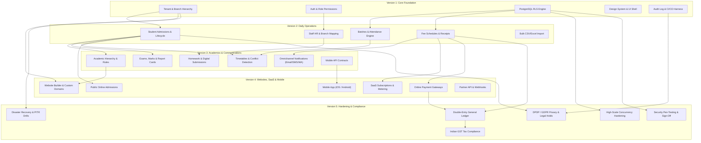

# InstituteOS — Strict Five-Version Implementation Roadmap

**Document Version:** 1.0.0  
**Status:** Approved Architectural Blueprint  
**Governance Constraint:** Exactly 5 Implementation Versions (V1–V5). No V6.  

---

## 1. Roadmap Executive Summary & Rules of Governance

The InstituteOS platform implementation is governed by a strict, non-negotiable **Five-Version Roadmap**. To prevent scope creep, architectural debt, and premature infrastructure costs, every feature is assigned to exactly one primary version for foundational release, with clear exit gates before the subsequent version may commence.

### Non-Negotiable Roadmap Invariants
1. **Exactly Five Versions:** The project roadmap terminates at V5. No V6 will be planned. Any features not fitting into V1–V5 must be explicitly marked as **Deferred** beyond the core product release.
2. **Audit & Acceptance Gate:** Development on Version \(N+1\) cannot begin until Version \(N\) undergoes a formal security, functional, and performance audit with explicit stakeholder sign-off.
3. **Free-Tier-First Cost Model:** V1 through V3 are architected to operate entirely within free/low-cost development tiers. Paid infrastructure (production compute, dedicated domains, SMS credits, mobile app store licenses) is introduced only where strictly necessary in V4 and V5.
4. **Zero Code Before Plan Approval:** No production code, scaffolding, or database migrations will be executed until this roadmap and its companion planning documents are approved.

---

## 2. Master Version Progression Matrix

```
┌─────────────────────────────────────────────────────────────────────────────┐
│                       INSTITUTE-OS FIVE-STAGE LIFECYCLE                     │
├─────────────┬─────────────┬──────────────┬──────────────┬───────────────────┤
│     V1      │     V2      │      V3      │      V4      │        V5         │
│    CORE     │    DAILY    │  ACADEMICS & │   WEBSITES   │    PRODUCTION     │
│  FOUNDATION │ OPERATIONS  │COMMUNICATION │ & PLATFORM   │     HARDENING     │
├─────────────┼─────────────┼──────────────┼──────────────┼───────────────────┤
│ • Tenant Org│ • Student   │ • Academic   │ • Website    │ • Double-Entry GL │
│ • Branch RLS│   Admissions│   Hierarchy  │   Builder    │ • Full GST Engine │
│ • Auth/IAM  │ • Staff HR  │ • Timetables │ • Custom     │ • DPDP Privacy    │
│ • Migration │ • Batches   │ • Exams/Marks│   Domains    │ • Legal Holds     │
│   Baseline  │ • Daily/    │ • Report     │ • SaaS Plans │ • High-Scale Load │
│ • Shell UI  │   Period Att│   Cards      │   & Billing  │ • Disaster Recovery│
│ • Audit Log │ • Fee Plans │ • Homework   │ • Mobile App │ • Final Security  │
│ • CI / Test │ • Receipts  │ • Omnichannel│   (iOS/Droid)│   Pen-Testing     │
│   Harness   │ • CSV Import│   Notices    │ • Partner API│ • Production Exit │
└─────────────┴─────────────┴──────────────┴──────────────┴───────────────────┘
```

---

## 3. Detailed Version Breakdown

### Version 1: Core Foundation & Multi-Tenant Infrastructure

#### Objective
Establish the bulletproof multi-tenant core, logical tenant isolation with PostgreSQL Row-Level Security (RLS), authentication, role-based access control, design system, database migrations, and automated negative test harness.

#### Modules Delivered in V1
1. **Tenant & Organization Hierarchy:** `institutes`, `branches`, and organizational configurations.
2. **Identity & Access Management (IAM):** Role hierarchy (Owner, Admin, Branch Manager, Teacher, Accountant, Receptionist, Student), session management, password reset, and branch scoping.
3. **Database Schema & Migrations:** Foundational PostgreSQL schema with strictly enforced `institute_id` foreign keys, indexes, and automated migration tooling.
4. **PostgreSQL Row-Level Security (RLS):** Complete read/insert/update/delete policies bound to Supabase JWT claims (`institute_id`, `branch_id`, `role`).
5. **Shared Design System & Shell UI:** Next.js App Router shell with responsive navigation, theme provider, accessible shadcn/ui components, and language selector skeleton.
6. **Immutable Audit Log Foundation:** System audit log table and triggers capturing authentication, tenant configuration, and administrative mutations.
7. **CI/CD & Synthetic Multi-Tenant Test Harness:** Automated GitHub Actions pipeline running unit tests, database migration tests, and negative cross-tenant isolation test suites.

#### Module Specifications

| Module | Foundational Scope (V1) | Mature Scope (Later Versions) | Prerequisites | Acceptance Tests | Security / Privacy Risks | Complexity & Cost |
| :--- | :--- | :--- | :--- | :--- | :--- | :--- |
| **Tenant Isolation & RLS** | Logical database isolation via RLS on all tenant tables; JWT context injection. | Cross-branch dynamic permission delegation in V3; Enterprise VPC isolation in V5. | PostgreSQL 15+, Supabase Auth | Attempted queries from Tenant A cannot see Tenant B data; bypass attempts fail with 0 rows. | High: Data leakage across institutes. Mitigated via database-level RLS. | Medium complexity; $0/mo (Supabase Free Tier). |
| **Authentication & IAM** | Email/password, session refresh, logout, password recovery, standard role validation. | TOTP MFA in V5; OAuth/SSO deferred to Enterprise. | Supabase Auth | User can log in, switch branches (if authorized), and cannot access unassigned branches. | High: Credential stuffing, session hijacking. Mitigated via secure HTTP-only cookies and bcrypt. | Low complexity; $0/mo. |
| **UI Shell & Design System** | Responsive dashboard layout, sidebar, user profile menu, breadcrumbs, modal dialogs. | Role-customizable dashboard widgets in V4. | React 19, Next.js 15, Tailwind, shadcn/ui | Screen reader compatibility (WCAG 2.2 AA baseline), full mobile viewport responsiveness. | Low risk: UI state only. | Low complexity; $0/mo. |

#### V1 Exit Criteria
- 100% of tenant-owned tables enforce RLS with zero bypass vulnerabilities.
- Automated CI pipeline passes 50+ negative security tests asserting cross-tenant and cross-branch data isolation.
- Design system implements accessible dashboard shell supporting English, Hindi, and Marathi locale tokens.

---

### Version 2: Daily Operations, Admissions & Financial Tracking

#### Objective
Deliver the core operational engine required for an educational institute's day-to-day workflow: student admissions, staff registries, operational batches, daily/period attendance, fee collections, and immutable receipt generation.

#### Modules Delivered in V2
1. **Student Lifecycle & Admissions:** Enquiry capture, application form, document verification, enrollment into courses/divisions, student profile management.
2. **Staff Registry & Branch Assignments:** Faculty and administrative staff records, multi-branch assignments, contact details, and department allocations.
3. **Batches & Operational Scheduling:** Creation of coaching/class batches, capacity limits, teacher assignment, and basic calendar schedules.
4. **Attendance Tracking Engine:** Daily (once a day) and Period-wise (per timetable slot) student attendance recording with attendance status flags (Present, Absent, Late, Excused).
5. **Fee Structure & Schedules:** Configurable fee plans, recurring installment schedules, discounts/scholarships, and fine rules.
6. **Payment Collection & Receipts:** Multi-channel recording (Cash, UPI, Cheque, Bank Transfer), automated receipt numbering, tamper-proof PDF receipt generation.
7. **Dues & Balance Engine:** Real-time calculation of student outstanding balances, installment due dates, and defalcation reports.
8. **Bulk CSV/Excel Import:** Bulk onboarding of existing student profiles, parent contacts, and opening fee balances with duplicate validation.

#### Module Specifications

| Module | Foundational Scope (V2) | Mature Scope (Later Versions) | Prerequisites | Acceptance Tests | Security / Privacy Risks | Complexity & Cost |
| :--- | :--- | :--- | :--- | :--- | :--- | :--- |
| **Student Lifecycle & Admissions** | Student records, parent contact details, course enrollment, document metadata. | Automated online public admission portal in V4; Self-service student portal in V3. | V1 Auth, V1 Tenant Hierarchy | Enrolled student appears in correct class/division; unique student roll/ID per institute enforced. | High: Student PII disclosure (minors' data). Mitigated by strict staff role scoping. | Medium complexity; $0/mo. |
| **Attendance Engine** | Web dashboard attendance entry by teachers; daily & period modes; daily absence reports. | Offline mobile sync in V4; Biometric device webhook ingestion in V3. | V1 RLS, V2 Student Records | Teacher marks 40 students in < 30 seconds; duplicate attendance on same date/period is blocked. | Medium: Unauthorized attendance alteration. Mitigated by date-locking policies. | Medium complexity; $0/mo. |
| **Fee Collection & Receipts** | Manual recording of offline payments (Cash, UPI, Cheque); immutable PDF receipts. | Online gateway integration in V4; Full double-entry General Ledger in V5. | V1 Audit Log, V2 Student Records | Sequential receipt numbers have zero gaps; receipts cannot be updated or deleted once finalized. | High: Financial fraud, receipt tampering. Mitigated by append-only ledger entries and reversal notes. | High complexity; $0/mo. |

#### V2 Exit Criteria
- Institute can admit students, assign them to classes/batches, and track daily attendance.
- Staff can record fee collections, generate downloadable PDF receipts, and view real-time student outstanding dues.
- Bulk CSV import successfully validates, maps, and imports 500+ student records with zero data corruption.

---

### Version 3: Academics, Timetables & Omnichannel Communications

#### Objective
Enable complete academic management—grading, examinations, homework, and conflict-free timetables—coupled with automated, omnichannel parent/student notifications (Email, SMS, WhatsApp) and mobile API readiness.

#### Modules Delivered in V3
1. **Academic Hierarchy & Rules:** Academic year transitions, courses, semesters, subjects, elective mappings, and passing mark rules.
2. **Timetable & Facility Allocation:** Weekly timetable builder with automatic collision detection for teachers, classrooms, and batches.
3. **Examinations & Marksheets:** Exam scheduling, question bank repository, marks entry with validation boundaries, and GPA/percentage grade calculation.
4. **Report Card Generator:** Automated PDF report card engine with customizable grading scales, teacher remarks, and digital signature placeholders.
5. **Homework & Digital Assignments:** Teacher homework assignment creation, due date tracking, student file submission, and teacher feedback.
6. **Omnichannel Notification Engine:** Background notification worker supporting In-App alerts, transactional Email (Resend), Indian DLT-compliant SMS, and WhatsApp (Gupshup/Twilio).
7. **BYO Communication Credentials Vault:** Secure storage for institute-provided SMS and WhatsApp API credentials with AES-256-GCM encryption.
8. **Academic Calendar & Events:** Master institute calendar tracking terms, holidays, examination dates, and parent-teacher meetings.
9. **Mobile Backend API Readiness:** Versioned REST endpoints (`/api/v1/...`) supporting future mobile app authentication, push notifications, and data synchronization.

#### Module Specifications

| Module | Foundational Scope (V3) | Mature Scope (Later Versions) | Prerequisites | Acceptance Tests | Security / Privacy Risks | Complexity & Cost |
| :--- | :--- | :--- | :--- | :--- | :--- | :--- |
| **Timetable & Scheduling** | Weekly recurring timetable grid; conflict detection for faculty and rooms. | AI-assisted optimal schedule generation in V4. | V2 Batches, V2 Staff Records | Attempting to assign Teacher A to Room 1 and Room 2 at the same period raises an instant collision error. | Low risk: Operational scheduling data. | Medium complexity; $0/mo. |
| **Examinations & Report Cards** | Exam definition, marks entry, automated grade calculation, bulk PDF generation. | Online student assessment taking deferred to post-V5. | V2 Student Records, V3 Academic Hierarchy | Marks entry rejects values exceeding maximum marks; PDF report cards generate in batch (< 2 sec/card). | Medium: Unauthorized marks alteration. Mitigated by formal exam lock status. | High complexity; $0/mo. |
| **Omnichannel Notifications** | Background worker dispatching email, SMS, and WhatsApp alerts for absence and fees. | Chatbot messaging in V4; Advanced segmentation in V4. | V2 Daily Operations, Background Worker | Triggering absent alert queues notification; delivery logs capture carrier response; DLT template ID validated. | High: Privacy violation (sending PII to wrong number). Mitigated by phone verification and template locks. | High complexity; Low cost ($0 free tiers for dev; tenant pays SMS/WhatsApp fees via BYO). |

#### V3 Exit Criteria
- Faculty can schedule exams, record marks, and generate standardized PDF report cards.
- Absence and fee due triggers automatically dispatch verified Email and SMS notifications via background queue.
- Timetable builder prevents teacher and room scheduling collisions across all branches.

---

### Version 4: Public Websites, SaaS Platform & Mobile Applications

#### Objective
Transform InstituteOS into a complete commercial SaaS platform: institute website builder with custom domains and automated SSL, subscription billing and entitlements, developer APIs, and dedicated cross-platform mobile apps for iOS and Android.

#### Modules Delivered in V4
1. **Institute Public Website Builder:** No-code landing page editor for institutes showcasing courses, faculty, facilities, photo galleries, and contact information.
2. **Public Admissions & Enquiry Portal:** Embeddable public forms allowing prospective students to apply online, pay application fees, and upload documents.
3. **Custom Domain & SSL Provisioning Engine:** Automated DNS verification, CNAME routing, and automatic SSL certificate generation via Cloudflare/Vercel.
4. **Platform SaaS Subscription Engine:** Platform Super Admin billing module managing institute subscription plans (Starter, Growth, Enterprise), usage metering, and billing cycles.
5. **Online Payment Gateway Integration:** Server-side verified online fee payment via Razorpay / Stripe for student tuition and SaaS subscriptions.
6. **Cross-Platform Mobile Application (iOS & Android):** React Native / Expo application for students, parents, and teachers with offline attendance caching and push notifications.
7. **Offline Mobile Sync Architecture:** Local encrypted SQLite database with background queue and server-authoritative conflict resolution; strict prohibition of offline payment finalization.
8. **Developer API Sandbox & Webhooks:** Scoped API key issuance (`inst_live_...`), rate-limited REST endpoints, and signed outbound webhooks for customer integrations.

#### Module Specifications

| Module | Foundational Scope (V4) | Mature Scope (Later Versions) | Prerequisites | Acceptance Tests | Security / Privacy Risks | Complexity & Cost |
| :--- | :--- | :--- | :--- | :--- | :--- | :--- |
| **Website Builder & Domains** | Multi-tenant dynamic routing; custom CNAME mapping; responsive public landing pages. | Advanced drag-and-drop block builder deferred to post-V5. | V1 Tenant Hierarchy, V3 Academic Structure | Visiting `admissions.apex.com` renders Apex Academy's branding; valid SSL certificate served seamlessly. | Medium: Host-header injection, subdomain hijacking. Mitigated by DNS verification records. | High complexity; Low cost ($0 Cloudflare free tier). |
| **SaaS Subscription Billing** | Tiered plan enforcement, student count caps, grace periods, read-only mode transitions. | Enterprise multi-year invoicing in V5. | V1 Tenant Architecture, V2 Finance Engine | Tenant exceeding 500 active students on Starter Plan is blocked from admitting student 501 until upgraded. | High: Revenue leakage, unauthorized plan elevation. Mitigated by server-side entitlement checks. | High complexity; Gateway transaction fees (~2%). |
| **Mobile Applications** | Cross-platform app for Android/iOS; timetable, attendance, marks, offline attendance sync. | Biometric hardware push integration in V5. | V3 Mobile APIs, V4 Online Payments | Teacher records attendance offline; upon reconnect, records sync without overwriting newer server records. | High: Local device data compromise. Mitigated by encrypted local storage and biometrics. | Very High complexity; $25 (Play Store) + $99/yr (Apple Developer). |

#### V4 Exit Criteria
- Institutes can publish a custom-branded public website with verified custom domain SSL.
- Prospective students can submit online admission applications with server-verified online fee payments.
- Mobile application executes offline attendance recording and reconciles reliably upon reconnect.
- SaaS platform enforces plan student limits and transitions expired accounts into Read-Only mode without data loss.

---

### Version 5: Production Hardening, Enterprise Finance & Compliance

#### Objective
Harden the entire platform for enterprise scale, financial auditability, legal compliance, and disaster resilience: full double-entry general ledger, Indian GST compliance, DPDP/GDPR privacy workflows, high-concurrency load testing, and verified disaster recovery runbooks.

#### Modules Delivered in V5
1. **Double-Entry General Ledger:** Formal Chart of Accounts, automated balanced debit/credit journal postings for all transactions, trial balance, P&L, and balance sheet.
2. **Indian GST & Regional Tax Compliance:** Automated calculation of CGST, SGST, IGST, HSN/SAC codes, tax invoicing, and GST return export summaries.
3. **Staff Payroll & Expense Processing:** Salary components (Basic, HRA, PF, Deductions), payroll approval workflows, payslips, and vendor expense approvals.
4. **DPDP Act 2023 & GDPR Privacy Compliance:** Student personal data export, consent management, anonymization pipelines, and guardian verification workflows.
5. **Data Retention & Legal Holds:** Automated policy-driven data archival, configurable retention periods, and court/audit legal hold freezing mechanisms.
6. **High-Scale Load & Stress Hardening:** Database query tuning, connection pooling optimization (Supavisor), Redis caching, and simulated 10,000 concurrent user load testing.
7. **Disaster Recovery & PITR Verification:** Tested Point-in-Time Recovery procedures achieving RPO < 1 hour and RTO < 4 hours; automated offsite backup replication.
8. **Final Security Pen-Testing & Audit:** Independent security audit covering RLS bypass, OWASP Top 10, privilege escalation, and formal production readiness certification.

#### Module Specifications

| Module | Foundational Scope (V5) | Mature Scope (Later Versions) | Prerequisites | Acceptance Tests | Security / Privacy Risks | Complexity & Cost |
| :--- | :--- | :--- | :--- | :--- | :--- | :--- |
| **Double-Entry General Ledger** | Chart of Accounts, automated journal entries, balanced journal validation, financial statements. | Multi-currency consolidated group balance sheets deferred. | V2 Fee Collections, V4 SaaS Billing | Every financial transaction generates strictly equal sum(debits) and sum(credits); unbalanced entries error out. | Critical: Financial discrepancy, audit failure. Mitigated by database transaction constraints. | Very High complexity; $0/mo. |
| **Privacy & Legal Holds** | Data export in JSON/PDF, right to erasure anonymization, legal hold suspension of deletions. | Automated biometric template destruction in post-V5. | V1 Audit Logs, V2 Student Records | Placing student under legal hold blocks deletion requests; data export produces complete PII archive. | Critical: Regulatory penalties under DPDP Act 2023. Mitigated by automated compliance pipelines. | High complexity; $0/mo. |
| **Disaster Recovery & PITR** | Automated daily WAL archiving, cross-region backups, simulated restore drills with verified data. | Active-active multi-region database deferred. | V1-V4 Infrastructure | Restoring database from PITR snapshot 30 minutes prior recovers 100% of verified test data in < 2 hours. | Critical: Permanent catastrophic data loss. Mitigated by tested offsite backup replication. | High complexity; ~$25/mo (Supabase Pro for PITR). |

#### V5 Exit Criteria
- Double-entry ledger maintains 100% balance across all financial transactions with verified GST tax reporting.
- Platform passes comprehensive security penetration testing with zero critical or high vulnerabilities.
- Disaster recovery drill proves complete database restoration within RTO < 4 hours and RPO < 1 hour.
- Platform sustains 10,000 simulated concurrent requests with p95 response time < 500ms and zero RLS data leaks.

---

## 4. Explicitly Deferred Features & Out-of-Scope Registry

To maintain focus and guarantee delivery within the 5-version constraint, the following modules are formally deferred beyond the V1–V5 roadmap:

1. **Hostel & Dormitory Management:** Bed allocation, mess billing, and night curfew tracking.
2. **Fleet GPS Real-Time Telematics:** Real-time bus tracking on maps, driver mobile tracking, and fuel sensor integration.
3. **Advanced Library RFID & Barcode Gate Antennas:** Physical hardware turnstile integrations.
4. **Online Proctored Examination Engine:** AI webcam face-tracking and lockdown browser technology.
5. **Separate Standalone App Store Publishing for Individual Tenants:** Submitting 50+ unique white-label apps to Apple App Store / Google Play (deferred to custom enterprise contracts due to developer account and review maintenance overhead).
6. **Multi-Currency Global Cross-Border Tax Engine:** Multi-currency currency fluctuation ledgering (InstituteOS targets domestic currencies initially, prioritizing INR).

---

## 5. Roadmap Dependency Graph



---

## 6. Version Governance & Audit Sign-Off Protocol

Every implementation phase must terminate with a formal Audit Gate:
1. **Verification Test Run:** 100% automated test pass rate (Unit, Integration, RLS, E2E).
2. **Security & Isolation Check:** Static code analysis, dependency vulnerability scan, and negative tenant penetration tests.
3. **Budget & Quota Verification:** Verification that operational costs remain within authorized limits.
4. **Sign-off Artifact:** Generation of a `VERSION_X_AUDIT_REPORT.md` signed by Lead Architect and QA Lead prior to advancing to Version \(X+1\).
