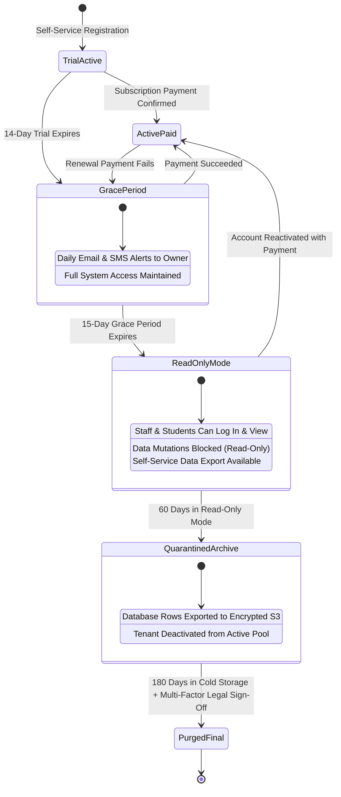

# InstituteOS — Security, Privacy & Data Lifecycle Governance

**Document Version:** 1.0.0  
**Status:** Approved Architectural Specification  
**Compliance Standards:** India Digital Personal Data Protection (DPDP) Act 2023, GDPR Principles, OWASP Top 10  
**Data Ownership Model:** Institute Fiduciary Ownership; Platform Data Processor  

---

## 1. Threat Model & STRIDE Vulnerability Analysis

A comprehensive STRIDE threat model was conducted across the multi-tenant architecture to identify attack surfaces and mandate defensive controls:

```
┌────────────────────────────────────────────────────────────────────────┐
│                        STRIDE THREAT MITIGATIONS                       │
├────────────────────┬───────────────────────┬───────────────────────────┤
│ THREAT CATEGORY    │ SYSTEM VULNERABILITY  │ ARCHITECTURAL MITIGATION  │
├────────────────────┼───────────────────────┼───────────────────────────┤
│ Spoofing           │ Stolen user session / │ Cryptographic Supabase JWT│
│                    │ forged tenant header  │ with HTTP-Only cookies;   │
│                    │                       │ domain slug assertions    │
├────────────────────┼───────────────────────┼───────────────────────────┤
│ Tampering          │ Manipulating payment  │ Server-side webhook HMAC  │
│                    │ status or fee dues    │ verification; append-only │
│                    │ in client requests    │ ledger; database triggers │
├────────────────────┼───────────────────────┼───────────────────────────┤
│ Repudiation        │ Denying grade changes │ Immutable `audit_logs`    │
│                    │ or fee adjustments    │ capturing user_id, IP,    │
│                    │                       │ diff, and timestamp       │
├────────────────────┼───────────────────────┼───────────────────────────┤
│ Information        │ Cross-tenant data     │ Database-level PostgreSQL │
│ Disclosure         │ leakage via API query │ Row-Level Security (RLS)  │
│                    │                       │ on 100% of tenant tables  │
├────────────────────┼───────────────────────┼───────────────────────────┤
│ Denial of          │ Resource exhaustion   │ Edge rate limiting; token │
│ Service (DoS)      │ via bulk query abuse  │ buckets; connection pooler│
│                    │                       │ (Supavisor); max limits   │
├────────────────────┼───────────────────────┼───────────────────────────┤
│ Elevation of       │ Staff role modifying  │ Hierarchical RBAC checks  │
│ Privilege          │ root tenant settings  │ in middleware & Server    │
│                    │                       │ Actions; restricted keys  │
└────────────────────┴───────────────────────┴───────────────────────────┘
```

---

## 2. Privacy, Regulatory Compliance & Minor Protection (DPDP Act 2023)

Educational platforms operate as **Data Fiduciaries** processing high volumes of personal data belonging to children and minors.

### Data Ownership Invariant
**The institute owns 100% of its institutional, academic, financial, and student data.** The InstituteOS platform operates strictly as a data processor. Data will never be mined, monetized, sold, or shared with third parties for marketing or profiling.

### Minors' Data Protection Controls
1. **Verifiable Parental Consent (VPC):** Under the DPDP Act 2023, processing personal data of children requires verifiable consent from a parent or legal guardian. During admission, guardian identity and consent are captured and logged.
2. **Prohibition of Behavioral Profiling:** The platform strictly prohibits targeted behavioral tracking, tracking cookies, or profiling algorithms on student accounts.
3. **Data Portability & Right to Erasure:**
   - **Right to Access:** Students and parents can download an encrypted machine-readable archive (JSON/PDF) of all personal, academic, and attendance data.
   - **Right to Erasure / Anonymization:** Upon formal written request from an institute owner or guardian, personal identifiers (name, phone, Aadhaar, address) are permanently overwritten with cryptographic hashes (`ANONYMIZED_USER_8f1a...`), preserving statistical academic aggregates and historical financial audit balances without retaining PII.

---

## 3. Secure Document & File Storage Lifecycle

Physical files (Aadhaar cards, birth certificates, medical forms, mark sheets) are isolated from application servers:

```
┌────────────────────────────────────────────────────────────────────────┐
│                        OBJECT STORAGE SECURITY                         │
├──────────────────────────┬─────────────────────────────────────────────┤
│ Storage Architecture     │ Private S3 / Supabase Storage Buckets       │
│ Direct Public Access     │ GLOBALLY DISABLED                           │
│ Transmission Security    │ TLS 1.3 Strict In-Transit                   │
│ Encryption at Rest       │ AES-256 Server-Side Encryption (SSE-S3)     │
│ Access Control Mechanism │ Pre-Signed Ephemeral URLs (Max 15 min TTL)  │
│ Content Validation       │ Server-side MIME check & Virus Scan hook    │
└──────────────────────────┴─────────────────────────────────────────────┘
```

### File Upload & Download Sequence
1. **Direct Upload via Pre-Signed PUT URL:** To protect Next.js servers from memory exhaustion during large file uploads, clients request a pre-signed upload URL. The server validates user quota, file type (PDF, PNG, JPG only; maximum 5MB), and issues an upload token.
2. **Server-Side Verification & Storage Event:** Once uploaded, a background trigger computes the SHA-256 checksum, verifies MIME integrity, and registers the document in the `files` table linked to the student profile.
3. **Authorized Download:** Downloads verify caller tenant and branch RLS permissions before returning a short-lived signed GET URL.

---

## 4. Institute Data Lifecycle, Decommissioning & Zero Silent Deletion

A foundational tenet of InstituteOS (**Non-Negotiable Rule 5.A**) is the **Zero Silent Deletion Guarantee**: under no circumstance will an institute's database records be silently destroyed due to billing expiration, payment gateway failures, or administrative inactivity.

### Comprehensive Tenant Lifecycle State Machine



### Lifecycle Stage Policies
1. **Active (Paid / Trial):** Full operational capability.
2. **Grace Period (15 Days):** If a subscription renewal fails, the tenant enters a 15-day grace period. Operations continue uninterrupted while billing reminders are sent to the Owner.
3. **Read-Only Mode (60 Days):** If payment is not resolved after 15 days, the tenant transitions to Read-Only Mode. Teachers and students can log in, view timetables, and download report cards/receipts, but all data inserts, updates, and fee collections are blocked. The Institute Owner can download a complete data export at any time.
4. **Quarantined Cold Archive (180 Days):** After 60 days of read-only suspension, tenant records are migrated to an encrypted cold storage archive (`.tar.gz.enc`). Tenant tables are removed from the active connection pool.
5. **Permanent Decommissioning:** Deletion of cold storage archives occurs only after 180 days in quarantine and requires dual-signoff from the Platform Security Lead and Institute Owner.

---

## 5. Legal Holds & Archival Governance

In the event of litigation, government audit, or academic arbitration, institutional records must be protected from routine retention purging:

```sql
-- Placing an entity under legal hold blocks deletion triggers
CREATE OR REPLACE FUNCTION check_legal_hold_before_delete() RETURNS TRIGGER AS $$
DECLARE
    v_hold_count INT;
BEGIN
    SELECT COUNT(*) INTO v_hold_count
    FROM legal_holds
    WHERE target_id = OLD.id AND released_at IS NULL;

    IF v_hold_count > 0 THEN
        RAISE EXCEPTION 'Action Prohibited: Record is subject to an active Legal Hold and cannot be deleted.';
    END IF;

    RETURN OLD;
END;
$$ LANGUAGE plpgsql;
```

---

## 6. AI Privacy & Sanitization Gateway

When optional AI features are enabled (e.g., syllabus generation, admission chatbot, student performance insights):
1. **Zero Training Data Policy:** Enterprise API contracts with LLM providers (Google Gemini / OpenAI) strictly mandate that prompt data is not retained or used for foundation model training.
2. **PII Anonymization Pipeline:** Prior to dispatching any prompt payload to external LLM endpoints, the text is processed through a deterministic regex/NER filter that scrubs or pseudonymizes:
   - Student Names -> `Student_1`, `Student_2`
   - Phone Numbers & Emails -> `[REDACTED_CONTACT]`
   - Aadhaar & Government IDs -> `[REDACTED_GOVT_ID]`
3. **Institute-Level Token Quotas:** Institutes define maximum monthly token budgets, preventing surprise billing overruns.

---

## 7. Security Incident Response & Disclosure Protocol

1. **Detection & Containment (< 1 Hour):** Automated anomalous traffic detection (e.g. bulk RLS failures, brute-force login attempts) alerts the on-call security engineer; compromised sessions are revoked globally via Supabase Auth admin API.
2. **Eradication & Forensics (< 4 Hours):** Root cause analysis utilizing immutable `audit_logs` and VPC flow logs.
3. **Notification & Transparency (< 24 Hours):** In compliance with the India DPDP Act and global data regulations, affected tenant institute administrators and relevant regulatory authorities are notified within 72 hours of verified data compromise, accompanied by clear remediation guidance and transparent status page updates.
