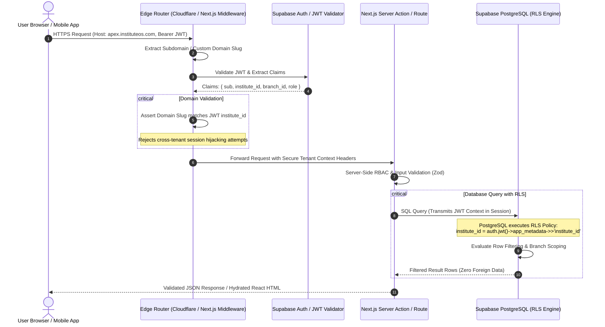
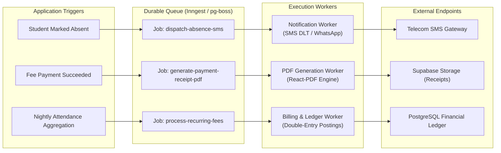
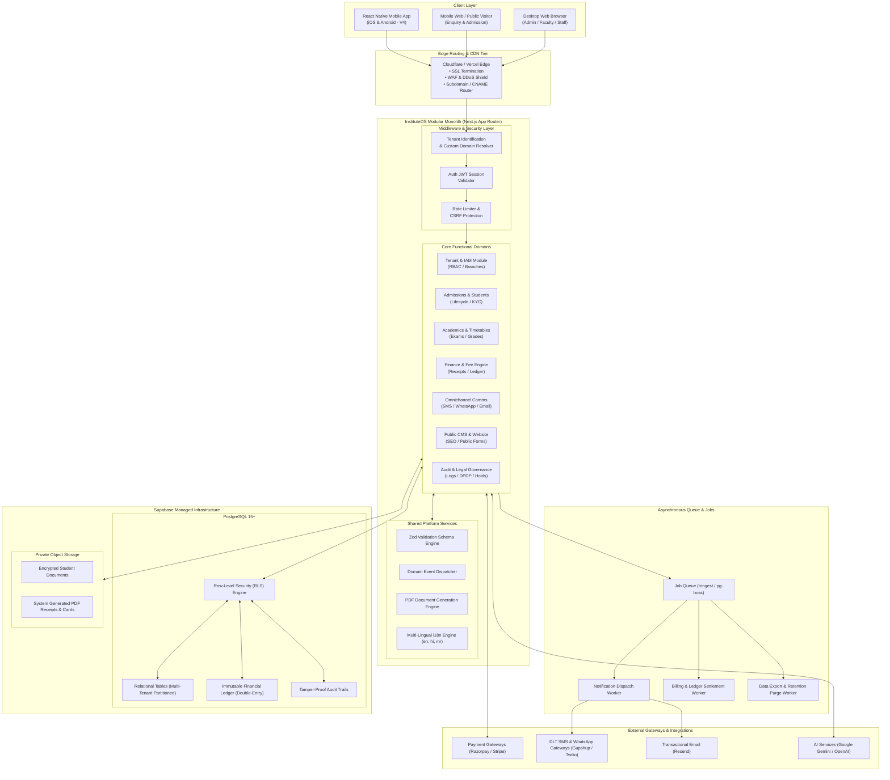

# InstituteOS — System Architecture Specification

**Document Version:** 1.0.0  
**Status:** Approved Architectural Blueprint  
**Architecture Pattern:** Multi-Tenant Modular Monolith  
**Primary Tech Stack:** Next.js App Router, React 19, TypeScript, Tailwind CSS, Supabase PostgreSQL, Supabase Auth, Storage & RLS  

---

## 1. Architectural Philosophy & Strategy

InstituteOS is designed as an enterprise-grade **Modular Monolith**. This strategic choice balances developer velocity, cognitive overhead, strict transactional integrity, and operational cost efficiency during the critical V1–V5 implementation phases.

### Why a Modular Monolith over Microservices?
1. **Financial & Academic Atomicity:** Educational operations inherently require atomic multi-table transactions (e.g. admitting a student, creating fee schedules, posting initial opening balances, and allocating classroom seats). A shared PostgreSQL database ensures ACID compliance without distributed transactions or eventual consistency lag.
2. **Operational Cost Minimization:** Running microservices mandates multiple container clusters, distributed tracing, service meshes, and duplicate databases, directly violating the **Free-Tier-First** mandate. A modular monolith deploys as a cohesive, serverless/edge-optimized Next.js application.
3. **Enforced Boundary Discipline:** Modularity is enforced logically via strict internal package/domain boundaries within the codebase, rather than physical network boundaries. If specific modules (e.g. background notification workers or high-throughput analytics) require dedicated compute in the future, the clean domain separation enables frictionless extraction.

---

## 2. High-Level System Context & Component Responsibilities

The InstituteOS ecosystem encompasses five primary functional tiers:

```
┌───────────────────────────────────────────────────────────────────────────┐
│                           CLIENT / ACCESS TIER                            │
│  ┌───────────────────────┐  ┌──────────────────────┐  ┌────────────────┐  │
│  │   Staff & Admin Web   │  │ Student/Parent Portal│  │ Public Websites│  │
│  │   Next.js SSR/RSC     │  │   React Mobile App   │  │ Custom Domains │  │
│  └───────────┬───────────┘  └──────────┬───────────┘  └────────┬───────┘  │
└──────────────┼─────────────────────────┼───────────────────────┼──────────┘
               │                         │                       │
┌──────────────▼─────────────────────────▼───────────────────────▼──────────┐
│                   EDGE ROUTING & API GATEWAY TIER                         │
│   Cloudflare CDN / Vercel Edge Network                                    │
│   • SSL Termination & Custom Domain Routing                               │
│   • Rate Limiting & DDoS Shield                                           │
│   • Tenant Subdomain / Host Header Resolution                             │
└────────────────────────────────────┬──────────────────────────────────────┘
                                     │
┌────────────────────────────────────▼──────────────────────────────────────┐
│                  APPLICATION CORE (MODULAR MONOLITH)                      │
│   Next.js App Router (Server Components, Server Actions & Route Handlers) │
│                                                                           │
│   ┌───────────────┐ ┌───────────────┐ ┌───────────────┐ ┌───────────────┐ │
│   │ Tenant & Auth │ │ Student & HR  │ │ Academic Core │ │ Finance & GL  │ │
│   │    Domain     │ │    Domain     │ │    Domain     │ │    Domain     │ │
│   └───────────────┘ └───────────────┘ └───────────────┘ └───────────────┘ │
│   ┌───────────────┐ ┌───────────────┐ ┌───────────────┐ ┌───────────────┐ │
│   │ Comms & Event │ │ CMS & Website │ │ Super Admin & │ │ Audit & Legal │ │
│   │    Domain     │ │    Domain     │ │ Subscriptions │ │   Governance  │ │
│   └───────────────┘ └───────────────┘ └───────────────┘ └───────────────┘ │
└────────────────────────────────────┬──────────────────────────────────────┘
                                     │
┌────────────────────────────────────▼──────────────────────────────────────┐
│                    PERSISTENCE & STORAGE TIER                             │
│   Supabase Managed Infrastructure                                         │
│   ┌────────────────────────────────┐  ┌────────────────────────────────┐  │
│   │     PostgreSQL Database        │  │     Encrypted Object Storage   │  │
│   │  • Row-Level Security (RLS)    │  │  • Private Buckets             │  │
│   │  • Tenant & Branch Scoping     │  │  • Short-Lived Signed URLs     │  │
│   │  • Double-Entry Immutability   │  │  • Resumes, Documents, Photos  │  │
│   │  • Connection Pooling (Supav.) │  │                                │  │
│   └────────────────────────────────┘  └────────────────────────────────┘  │
└────────────────────────────────────┬──────────────────────────────────────┘
                                     │
┌────────────────────────────────────▼──────────────────────────────────────┐
│                   ASYNC & EXTERNAL SERVICES TIER                          │
│   ┌────────────────────────────────┐  ┌────────────────────────────────┐  │
│   │   Background Queue Worker      │  │    External Gateway Integrations│  │
│   │  • Inngest / pg-boss Worker    │  │  • Payment: Razorpay / Stripe  │  │
│   │  • Idempotent Job Execution    │  │  • SMS: DLT Telecom Gateways   │  │
│   │  • Retries & Dead-Letter Queue │  │  • WhatsApp: Gupshup / Twilio  │  │
│   │  • Notification Dispatch       │  │  • Email: Resend / SendGrid    │  │
│   │  • Periodic Cron Maintenance   │  │  • AI: Google Gemini / OpenAI  │  │
│   └────────────────────────────────┘  └────────────────────────────────┘  │
└───────────────────────────────────────────────────────────────────────────┘
```

---

## 3. Modular Monolith Domain Boundaries

To guarantee code maintainability, high testability, and zero circular dependencies, the application logic is partitioned into eight isolated functional domains located under `src/modules/`:

```
src/
├── app/                          # Next.js App Router (Routes, Layouts, Server Actions)
│   ├── (auth)/                   # Authentication flows (Login, Forgot Password, MFA)
│   ├── (dashboard)/              # Role-aware authenticated workspaces
│   │   ├── [tenantSlug]/         # Tenant-scoped dashboard shell
│   │   │   ├── admin/            # Institute & Branch administrative views
│   │   │   ├── academics/        # Timetables, exams, classes, batches
│   │   │   ├── finance/          # Fees, receipts, ledger, expenses
│   │   │   └── communications/   # Notifications, announcements, logs
│   │   └── portal/               # Student / Parent shared portal
│   ├── (super-admin)/            # Platform management & SaaS billing
│   ├── (public-cms)/             # Dynamic tenant public websites & admission forms
│   └── api/                      # Versioned REST APIs & Webhook endpoints
│       └── v1/
├── modules/                      # Domain Business Logic & Services
│   ├── tenant/                   # Tenant lifecycle, branches, subscriptions
│   ├── iam/                      # Identity, roles, permissions, session context
│   ├── academics/                # Courses, classes, batches, attendance, exams
│   ├── admissions/               # Leads, applications, student verification
│   ├── finance/                  # Fee structures, payments, receipts, ledger
│   ├── communications/           # Notification engine, DLT SMS, WhatsApp, Email
│   ├── cms/                      # Website builder, public themes, domain routing
│   └── audit/                    # Audit logging, privacy requests, legal holds
├── shared/                       # Cross-cutting utilities & infrastructure
│   ├── db/                       # Supabase client, migrations, typed schema
│   ├── ui/                       # shadcn/ui accessible components, design tokens
│   ├── errors/                   # Standardized application error classes
│   ├── events/                   # In-process domain event bus & dispatchers
│   └── i18n/                     # Localization dictionaries (en, hi, mr)
```

### Module Coupling Rules
1. **Direct Database Queries:** Modules may only query their own primary database tables directly. Cross-domain queries must be executed via public domain service interfaces or typed database view contracts.
2. **Domain Events:** Asynchronous side effects (e.g., student admission triggering fee schedule generation and welcome SMS dispatch) are decoupled using domain events.
3. **No Circular Dependencies:** The dependency graph flows downward from `app/` -> `modules/` -> `shared/`.

---

## 4. Multi-Tenant Request Lifecycle & Security Flow

Every incoming HTTP request undergoes rigorous, multi-layered tenant identification and authorization before accessing application logic or database rows:



---

## 5. Storage Architecture & Document Security

Educational institutions manage highly sensitive documents, including minor student identification (Aadhaar, birth certificates), academic transcripts, and financial records.

### Separation of Metadata and File Storage
- **Metadata in PostgreSQL:** File records (`files` table) track `file_id`, `institute_id`, `branch_id`, `uploaded_by_user_id`, `mime_type`, `byte_size`, `encryption_hash`, and strict access tags.
- **Physical Objects in Private Storage:** Files are stored in Supabase Storage / S3-compatible private buckets. **Public bucket access is disabled globally.**
- **Pre-Signed URL Access Model:**
  1. Client requests access to view a document.
  2. Server verifies caller's role, tenant, and branch permissions against the document metadata.
  3. Server generates a time-limited, cryptographic pre-signed URL (TTL: maximum 15 minutes).
  4. Client downloads the file directly from object storage via the signed URL.

---

## 6. Background Processing & Asynchronous Jobs

To prevent request timeouts, optimize serverless resource limits, and guarantee reliable execution, asynchronous workloads are processed through a durable queue engine:



### Reliability & Idempotency Rules
1. **Idempotency Keys:** Every background job requires a deterministic `idempotency_key` (e.g. `sms-absent-student-{id}-date-{date}`). Duplicate events within 24 hours are discarded.
2. **Exponential Backoff:** Transient network failures (e.g. telecom gateway timeouts) retry with exponential backoff up to 5 times.
3. **Dead-Letter Queue (DLQ):** Permanently failed jobs route to a DLQ table triggering an administrative notification for manual inspection.

---

## 7. Public Website Builder & Dynamic Custom Domain Architecture

InstituteOS provides an integrated website builder allowing each institute to maintain an independent web presence (`https://apex.edu.in`) powered by the central platform:

1. **CNAME DNS Binding:** The institute points their custom domain CNAME to `custom.instituteos.com`.
2. **Edge SSL Provisioning:** Vercel Edge / Cloudflare for Platforms dynamically validates domain ownership via DNS TXT challenge and provisions a Let's Encrypt TLS/SSL certificate.
3. **Dynamic Host Resolution:** Next.js middleware inspects the incoming `Host` header (`admissions.apexacademy.com`), queries the cached `institute_domains` table in Redis/PostgreSQL, and renders the specific institute's customized public template.
4. **Isolated Public Forms:** Public enquiry and online admission forms submit directly to server-validated API routes that enforce strict rate limiting and CAPTCHA protection to prevent spam abuse.

---

## 8. Technology Stack Evaluation & Architectural Invariants

| Component | Selected Technology | Architectural Rationale |
| :--- | :--- | :--- |
| **Frontend Framework** | Next.js 15+ App Router, React 19 | Server-Side Rendering (SSR) for blazing-fast public websites, React Server Components (RSC) for minimal client bundle size, and native Server Actions for secure data mutations. |
| **Language & Typing** | TypeScript 5.5+ (Strict Mode) | End-to-end type safety from database schema (via Supabase CLI typegen) to UI components, preventing runtime null-pointer and type coercion defects. |
| **Styling & Components**| Tailwind CSS & shadcn/ui (Radix UI) | High-performance, zero-runtime utility styling coupled with accessible, unstyled primitive components compliant with WCAG 2.2 AA. |
| **Database & Auth** | Supabase PostgreSQL 15+ & Supabase Auth | Enterprise relational capabilities with native Row-Level Security, ACID transactional integrity, and battle-tested GoTrue authentication with JWT support. |
| **Mobile Application** | React Native / Expo (V4) | Cross-platform mobile development sharing TypeScript interfaces, validation schemas, and API client libraries with the core web platform. |
| **State Management** | TanStack Query (React Query) & Zustand | Server state caching, optimistic UI updates, and lightweight client state management. |

---

## 9. Comprehensive System Architecture Diagram


