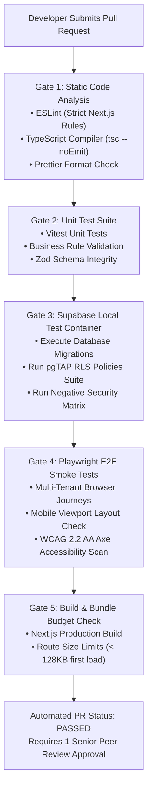

# InstituteOS — Testing, Quality Assurance & Release Governance

**Document Version:** 1.0.0  
**Status:** Approved Architectural Specification  
**Quality Target:** 100% Deterministic Tenant Isolation & Financial Integrity  
**CI/CD Pipeline:** Automated GitHub Actions with Multi-Tenant Seed Harness  

---

## 1. Testing Pyramid & Verification Framework

To deliver an enterprise SaaS platform with zero multi-tenant leakage and infallible financial accounting, InstituteOS enforces a structured, four-tier testing hierarchy:

```
                  /\
                 /  \     Level 4: End-to-End (Playwright)
                / E2E\    Full browser workflows across multi-tenant contexts
               /------\
              /  API   \   Level 3: API & Route Handlers (Vitest / Supertest)
             /Integration\ Server actions, permissions, status codes, Zod
            /-------------\
           /   Database    \  Level 2: RLS & Schema Tests (pgTAP / Supabase Test)
          /   & RLS Suite   \ Real PostgreSQL queries testing policy boundaries
         /-------------------\
        /     Unit Tests      \  Level 1: Pure Functions & Logic (Vitest)
       /  (Fee Math, Tax Calc) \ Fee installments, report formulas, date rules
      /-------------------------\
```

---

## 2. Test Suites by Architectural Category

### Level 1: Unit Testing (Vitest)
- **Target:** Isolated pure TypeScript functions, business rule validation, tax calculation algorithms, and schema parsers.
- **Key Modules Tested:**
  - Fee schedule installment division and rounding math (preventing fraction-of-cent leakage).
  - Indian GST calculations (CGST/SGST 9%+9% vs IGST 18%).
  - Academic GPA and percentile ranking algorithms.
  - Zod validation schemas across all input mutations.

### Level 2: Database & Row-Level Security Integration (pgTAP / Supabase Local)
- **Target:** Real PostgreSQL execution testing RLS policies, trigger constraints, and double-entry immutability.
- **Execution Mechanism:** Tests run against a local Supabase PostgreSQL container initialized with seed fixtures.
- **Key Suites:**
  - `rls_isolation_test.sql`: Authenticates as Tenant A, attempts to read/insert rows in Tenant B tables, asserts zero rows returned.
  - `branch_scoping_test.sql`: Authenticates as Branch Manager 1, attempts to update student attendance in Branch 2, asserts failure.
  - `journal_balance_trigger_test.sql`: Attempts to insert an unbalanced journal entry (`debit: 1000, credit: 900`), asserts PostgreSQL transaction abort.

### Level 3: API & Server Action Integration (Vitest / Next.js Test Environment)
- **Target:** Next.js Server Actions, route handlers, middleware tenant resolution, and error handling.
- **Key Suites:**
  - Verification that requests with missing JWT claims return `401 Unauthorized`.
  - Verification that requests with invalid tenant slugs return `403 Forbidden`.
  - Rate-limiting token bucket exhaustion verification (`429 Too Many Requests`).

### Level 4: End-to-End Browser Journeys (Playwright)
- **Target:** Complete user journeys across modern browsers (Chromium, Firefox, WebKit) and mobile viewports.
- **Critical End-to-End Journeys Automated:**
  1. **Journey 1: Student Admission to Receipt:** Enquiry submission -> Staff admission approval -> Fee structure assignment -> Cash fee collection -> PDF receipt download and verification.
  2. **Journey 2: Faculty Attendance Workflow:** Teacher login -> Select Branch & Batch -> Bulk mark 30 students -> Submit -> Assert absence notification queued.
  3. **Journey 3: Cross-Tenant Negative Attack:** Attacker opens browser in Tenant A session, navigates directly to `https://tenant-b.instituteos.com/admin/students`, asserts instant redirection to access denied page.

---

## 3. Synthetic Multi-Tenant Test Data Generator

To eliminate the danger of testing with real student personal data or production records, InstituteOS utilizes a deterministic synthetic data generator (`@seed/synthetic-generator.ts`):

```typescript
// Architectural specification for synthetic multi-tenant test seed
export interface SyntheticTenantFixture {
  institute: {
    id: string;
    slug: string;
    brandName: string;
  };
  branches: Array<{
    id: string;
    code: string;
    name: string;
  }>;
  staff: Array<{
    userId: string;
    email: string;
    role: 'OWNER' | 'ADMIN' | 'BRANCH_MANAGER' | 'TEACHER' | 'ACCOUNTANT';
    assignedBranchIds: string[];
  }>;
  students: Array<{
    userId: string;
    admissionNumber: string;
    branchId: string;
    classId: string;
    divisionId: string;
    guardianPhone: string;
  }>;
  feePlans: Array<{
    studentId: string;
    totalAmount: number;
    paidAmount: number;
    balanceAmount: number;
  }>;
}
```

The seed generator creates two isolated test institutes (`Alpha Institute` and `Beta Academy`) with distinct branches, enabling automated assertion of cross-tenant negative tests in every CI run.

---

## 4. Continuous Integration & Deployment (CI/CD) Gates

Every GitHub Pull Request (PR) must pass strict automated validation gates before merging into protected branches (`main`, `staging`):



---

## 5. Database Migration Safety Rules & Rollback Governance

Database migrations can cause catastrophic service outages if executed carelessly on live multi-tenant tables:

### Migration Invariants
1. **Forward-Only, Non-Destructive Migrations:**
   - Production migrations never execute `DROP COLUMN` or `ALTER COLUMN TYPE` directly on live tables.
   - Schema modifications follow the **Expand and Contract** pattern:
     1. Add new nullable column (`Expand`).
     2. Deploy application code that reads new column and writes to both old and new.
     3. Backfill data in background batches.
     4. Deploy application code that writes only to new column.
     5. Remove old column in subsequent release (`Contract`).
2. **Safe Index Creation:** All production indexes must be created using `CREATE INDEX CONCURRENTLY` to prevent table locking during peak school operational hours.
3. **Automated Migration Check in CI:** The CI pipeline runs migrations against a dirty database state seeded with historical data to verify backward compatibility.

### Rollback Limitations & Protocols
- **Code Rollback:** Handled instantly via Vercel / Edge deployment rollbacks (restoring previous immutable build artifact within 60 seconds).
- **Database Rollback:** Because database state changes continuously with incoming fee collections and attendance records, rolling back database schemas via `DROP` commands is prohibited. Rollbacks are executed via compensating forward migrations.

---

## 6. Version-Specific Audit Checklist (V1–V5)

Before any implementation phase is formally declared complete and the subsequent version is unlocked, the following audit checklist must be signed off:

```
┌────────────────────────────────────────────────────────────────────────┐
│                   VERSION AUDIT SIGN-OFF CHECKLIST                     │
├────┬─────────────────────────────┬───────────────────────┬─────────────┤
│ VER│ AUDIT MILESTONE             │ VERIFICATION EVIDENCE │ STATUS      │
├────┼─────────────────────────────┼───────────────────────┼─────────────┤
│ V1 │ Tenant Isolation Audit      │ 100% RLS tests pass;  │ Pending Dev │
│    │                             │ 0 leakage in CI suite │             │
├────┼─────────────────────────────┼───────────────────────┼─────────────┤
│ V2 │ Financial & Attendance Audit│ Sequential receipts;  │ Pending Dev │
│    │                             │ 0 gaps; CSV batch test│             │
├────┼─────────────────────────────┼───────────────────────┼─────────────┤
│ V3 │ Notification & Marks Audit  │ DLT SMS logs verified;│ Pending Dev │
│    │                             │ GPA calculations match│             │
├────┼─────────────────────────────┼───────────────────────┼─────────────┤
│ V4 │ Domain & Payment Audit      │ Let's Encrypt SSL OK; │ Pending Dev │
│    │                             │ HMAC payment capture  │             │
├────┼─────────────────────────────┼───────────────────────┼─────────────┤
│ V5 │ Enterprise Hardening Audit  │ Balanced Ledger check;│ Pending Dev │
│    │                             │ PITR Restore in < 4h  │             │
└────┴─────────────────────────────┴───────────────────────┴─────────────┘
```
